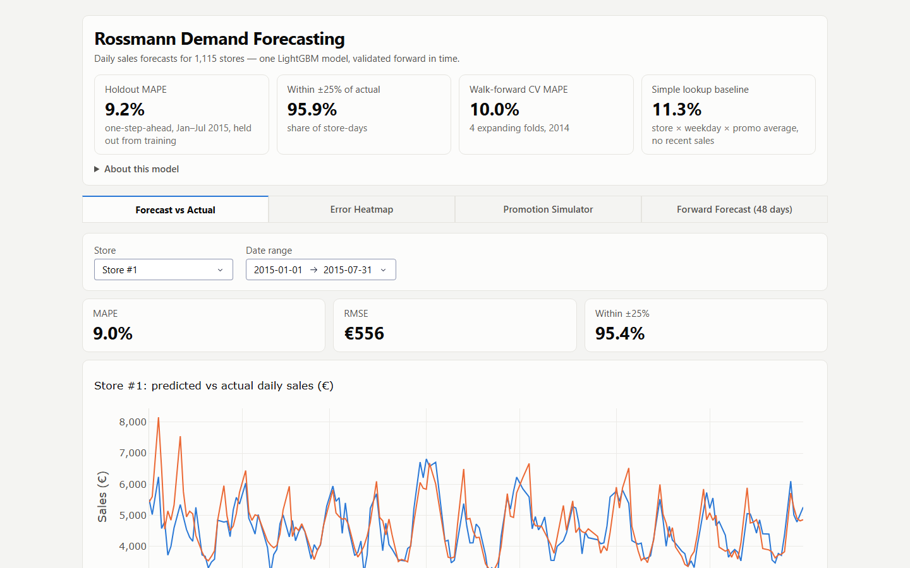

# Rossmann Demand Forecasting

**Live demo:** https://rossmann-demand-forecasting.onrender.com/ — hosted on Render's free tier, so if it has been idle the first load shows a "starting up" page for up to a minute.



One LightGBM model that forecasts daily sales for all 1,115 Rossmann drugstores, built on the public Kaggle
*Rossmann Store Sales* data (Jan 2013–Jul 2015), with an interactive dashboard. It is written for hiring managers and
technical readers who want to see how the forecasts were built and how far they can be trusted. With it you can compare
predictions with actual sales for any store, see where the model is weakest, test a "what if this store ran a
promotion?" scenario, and view a 48-day forecast.

Rossmann's store managers plan staffing and stock up to six weeks ahead. Accurate forecasts reduce stockouts and excess
inventory. Sales depend on promotions, holidays, store type, competition and how the store has been selling lately.

## Results

MAPE (mean absolute percentage error: the typical forecast is this far, in percent, from actual sales; lower is better)
on January–July 2015, data the model was not trained on:

| Predictor | One day ahead, all stores | A month ahead, 150-store July sample |
|---|---|---|
| Average sales for the same store, weekday and promo status in 2013–14 (no model) | 11.3% | 11.4% |
| **LightGBM** | **9.15%** | **10.4%** |

- **One day ahead** means the model sees the real sales of the previous days. It beats the simple average by about
  2 points (a 19% cut in error).
- **A month ahead** means the model forecasts from its own earlier predictions, which is the case managers plan with.
  The advantage over the simple average shrinks to about 1 point (a 9% cut). This figure comes from one month and 150
  stores (`analysis/backtest_recursive.py`), not the full period.
- **Treat 9.15% as mildly optimistic.** The January–July 2015 data was never trained on, but its score was checked while
  features were being chosen. The 2014 walk-forward cross-validation, with a mean MAPE of 10.0% (folds between 8.9%
  and 11.1%), is the cleaner estimate. See [Methodology](docs/METHODOLOGY.md#2-validation-design).
- A classical ARIMA model reaches 17.2% on Store 1, but it is a weak reference: it forecasts a constant after five days
  and gets no new information, so beating it says little.

## Dashboard

Charts zoom (drag to zoom, double-click to reset). Four tabs:

1. **Forecast vs Actual:** one-day-ahead predictions per store, with MAPE, RMSE (root mean squared error, in euros) and
   the share of forecasts within ±25%.
2. **Error Heatmap:** MAPE by store and week, worst stores first.
3. **Promotion Simulator:** force promotions on or off over a date range for one store and see the effect on forecast sales.
4. **Forward Forecast (48 days):** a day-by-day forecast for 1 Aug–17 Sep 2015, for up to five stores, individually
   or combined, with CSV export. Only the 856 stores in Kaggle's `test.csv` have a forward calendar.

## Data and features

- **Source:** Kaggle *Rossmann Store Sales*, provided by Dirk Rossmann GmbH
  ([competition page](https://www.kaggle.com/c/rossmann-store-sales)). Real, anonymized sales; the target is daily
  sales in euros.
- **Size:** 844,392 open-store-days. The model trains on 2013–2014 (648,360 rows) and is scored on January–July 2015
  (196,032 rows).
- **Features (42):** calendar (weekday, month); holidays (flags and days to the next and since the last holiday);
  promotions (flags, days to the next and since the last promotion, the recurring Promo2 programme); recent sales
  (sales 1, 7, 14 and 28 calendar days earlier, 7- and 30-day rolling means); store type, assortment and competition.
  The sales lags are exact calendar-day offsets, and no feature uses sales from the day being predicted or later.
  Details and the feature-by-feature evidence are in the [Methodology](docs/METHODOLOGY.md).

## How to run

**Quickest (no Kaggle download):** the repo ships `deploy_data/`, a compact copy of everything the dashboard needs.

```bash
# Python 3.14 (the version the pinned requirements were tested on)
pip install -r requirements-render.txt
python app.py
# open http://localhost:8050
```

**Full pipeline (from the raw Kaggle files):** put `train.csv`, `test.csv` and `store.csv` in `data/`, then:

```bash
pip install -r requirements.txt
python eda.py                           # exploration summary and charts
python train_model.py                   # features, baselines, cross-validation, final model -> models/, metrics.json
python shap_analysis.py                 # feature importance
python build_deploy_data.py             # optional: refresh deploy_data/
python analysis/backtest_recursive.py   # optional: month-ahead backtest (needs only deploy_data/)
python analysis/ablations.py            # optional: feature ablations, about 20 minutes
python app.py                           # set ROSSMANN_USE_LOCAL_DATA=1 to use data/ and models/ instead of deploy_data/
```

**Tests:** `python -m pytest` (needs `pytest`; no Kaggle data) runs checks on small synthetic data that lags are exact
calendar-day offsets, that no feature leaks sales from the day being predicted, that the promotion and holiday features
behave as specified, and that the deployed model reproduces the saved predictions. They do not check dashboard layout
or the live deployment.

## Limitations

- **New stores** have no history, so the lag features fall back to zero.
- **Forecast bands** are a constant-width interval from the 2015 errors; they do not widen with the forecast horizon.
- **One holdout window** (seven months) that also guided feature choices; the month-ahead figure rests on one month.
- **Missing history:** 180 stores have no rows from July to December 2014, and the model reads that gap as zero sales.

More in the [Methodology](docs/METHODOLOGY.md#9-limitations), including deployment details.

## License

The code is released under the [MIT License](LICENSE). The Rossmann data itself is not covered by it: it was provided by
Dirk Rossmann GmbH through Kaggle and remains subject to the
[competition rules](https://www.kaggle.com/c/rossmann-store-sales/rules).

## Author

Brian | Data Analyst
